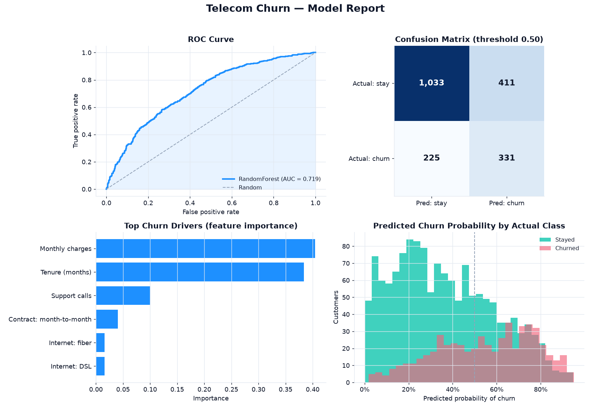

# 📡 Telecom Customer Churn Prediction

> A supervised-learning pipeline that scores every telecom customer for churn
> risk **and ranks the drivers behind it** — so retention teams know who to call
> and which lever to pull, not just a number.

<p>
  
  
  
  
  
  
</p>

---

## 📊 Model report

Generated by `src/train.py` on a held-out test set of 2,000 customers:



---

## Why this project

Telecom operators live and die by churn: winning a subscriber costs far more
than keeping one, so the retention question is never "how many will leave?" but
**"which accounts, and what's driving them out the door?"** This pipeline answers
both — it produces a per-customer churn probability the CRM can prioritise on,
and it ranks the features that move that probability so the intervention (a
tenure discount, a support-quality fix, a contract nudge) is aimed at the real
cause rather than a hunch.

## What it does

| Stage | File | Output |
|---|---|---|
| **Generate** a realistic churn dataset (churn driven by contract, tenure, support load, spend) | `src/generate_data.py` | `data/churn.csv` |
| **Train** a scaled + one-hot + class-balanced Random Forest | `src/train.py → build_pipeline()` | in-memory model |
| **Evaluate** into a bounded metric set (AUC, P/R/F1, confusion matrix, drivers) | `src/train.py → evaluate()` | `outputs/metrics.json` |
| **Visualise** a one-page model report (ROC, confusion matrix, drivers, score separation) | `src/train.py → dashboard()` | `outputs/*.png` |
| **Verify** dataset and model invariants | `tests/test_model.py` | `pytest` |

## 📈 Headline metrics (latest run)

Model: `RandomForestClassifier(n_estimators=300, max_depth=12, class_weight="balanced")`,
75/25 stratified split, seed 42. Numbers are deterministic — re-running reproduces them.

| Metric | Value |
|---|---|
| **ROC-AUC** | **0.719** |
| Accuracy | 0.682 |
| Churn-class precision | 0.446 |
| Churn-class recall | **0.595** |
| Churn-class F1 | 0.510 |
| Test-set churn rate | 27.8% |
| Train / test rows | 6,000 / 2,000 |

> Full machine-readable metrics: [`docs/metrics.json`](docs/metrics.json).

The model is deliberately tuned to favour **recall on the churn class** (0.595)
via `class_weight="balanced"`: in retention, missing a leaver (a false negative)
costs a customer, while a false positive costs one discretionary retention offer.
The confusion matrix in the report makes that trade-off explicit.

## 🔍 Ranked churn drivers

Feature importances from the fitted forest — the "so what" for the retention team:

| Rank | Driver | Importance |
|---|---|---|
| 1 | Monthly charges | 0.404 |
| 2 | Tenure (months) | 0.384 |
| 3 | Support calls | 0.100 |
| 4 | Contract: month-to-month | 0.040 |
| 5 | Internet: fiber | 0.016 |

Spend and tenure dominate: high-bill, low-tenure customers are the flight risk,
and every additional support call pushes probability up. That points retention
spend at early-life high-ARPU accounts and at fixing support friction — not at
blanket discounts.

## Methodology

- **Preprocessing** is inside the `Pipeline`, so scaling and encoding are fit on
  train only and never leak into the test fold: `StandardScaler` on the three
  numeric fields, `OneHotEncoder(handle_unknown="ignore")` on the two
  categoricals.
- **Model** — a Random Forest (300 trees, depth 12). `class_weight="balanced"`
  offsets the ~28% positive rate so the minority (churn) class isn't ignored.
- **Evaluation** — reported on a held-out stratified 25% split. ROC-AUC is the
  headline because it's threshold-independent; the confusion matrix and the
  probability-separation histogram show what happens at the operating threshold
  of 0.50.

## Data model

`generate_data.py` builds each customer from signals that make churn *learnable*
rather than random. Churn is drawn from a logistic model:

```
logit = -2.0
        + 0.90 · (contract == month-to-month)
        + 0.35 · support_calls
        - 0.03 · tenure_months
        + 0.012 · monthly_charges
        + 0.40 · (internet == fiber)
```

- **Reproducible** — `numpy` RNG seeded at 7 (data) and 42 (model).
- Schema (see [`docs/sample_data.csv`](docs/sample_data.csv)):
  `tenure_months · monthly_charges · contract · support_calls · internet_service · churned`

## ▶️ Run it

```bash
pip install -r requirements.txt
python src/generate_data.py     # writes data/churn.csv  (8,000 rows, ~28% churn)
python src/train.py             # prints report, writes outputs/ + docs/ artefacts
pytest -q                       # 8 tests
```

## 🧪 Tests

`tests/test_model.py` guards what must never silently break: the dataset schema,
a strictly binary target, a realistic churn base rate, valid value ranges,
`predict_proba` output shape and `[0,1]` bounds, every metric inside its
mathematical bounds with **ROC-AUC > 0.5** (beats random), a confusion matrix
that totals the test set, and feature importances that are ranked and sum to 1.

## 🗂️ Project structure

```
telecom-churn-prediction/
├── src/
│   ├── generate_data.py   # synthetic churn generator (seeded logistic model)
│   └── train.py           # pipeline + evaluation + one-page model report
├── tests/
│   └── test_model.py      # pytest invariants (data + model)
├── docs/                  # committed dashboard, ROC, metrics.json, data sample
├── requirements.txt
└── README.md
```

## 🛠️ Stack

`scikit-learn` · `pandas` · `numpy` · `matplotlib` · `pytest`

---

<sub>Part of my data & analytics portfolio — [github.com/syedjawaadali](https://github.com/syedjawaadali). Data is synthetic; no real customer information is used.</sub>
